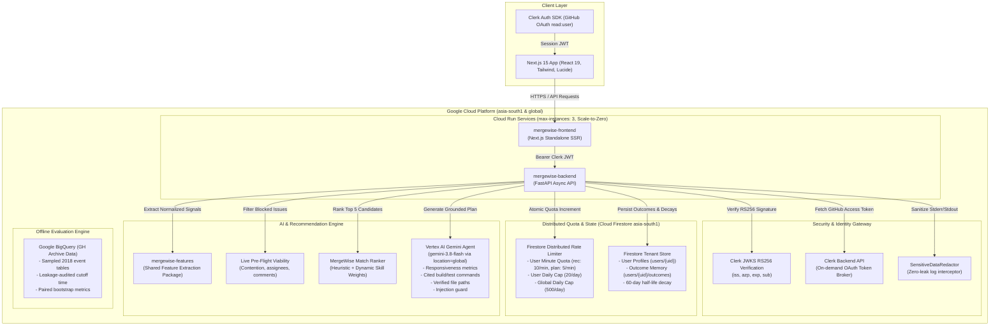

# MergeWise — Personalized OSS Match & Implementation Agent

A personalized open-source issue recommender and implementation agent. MergeWise analyzes a developer's GitHub footprint to construct a nuanced skill profile, identifies live viable newcomer issues matching their technical background, and drafts an actionable, grounded implementation starter plan using Google Vertex AI (`gemini-3.8-flash`) and outcome memory.

---

## 1. System Architecture



---

## 2. Quickstart & Local Setup

### Prerequisites
- **Python**: 3.11+
- **Node.js**: 18+ and `npm`
- **Google Cloud SDK (`gcloud`)**: authenticated via `gcloud auth application-default login`
- **Clerk Account**: with GitHub OAuth provider enabled

### Local Configuration

1. **Clone the repository**:
   ```bash
   git clone https://github.com/your-org/mergewise.git
   cd MergeWise
   ```

2. **Backend Setup**:
   ```bash
   cd backend
   python -m venv venv
   source venv/bin/activate  # Or `.\venv\Scripts\activate` on Windows
   pip install -r requirements.txt
   pip install -e ../shared
   ```
   Create `backend/.env` with:
   ```env
   ENVIRONMENT=development
   PORT=8000
   FRONTEND_URL=http://localhost:3000
   CLERK_SECRET_KEY=sk_test_...
   CLERK_PUBLISHABLE_KEY=pk_test_...
   CLERK_ISSUER=https://mutual-panther-6595.clerk.accounts.dev
   CLERK_AUTHORIZED_PARTIES=["http://localhost:3000","http://localhost:3005"]
   GEMINI_MODEL_ID=gemini-3.8-flash
   GCP_PROJECT_ID=oss-match
   GCP_LOCATION=global
   FIRESTORE_DATABASE_ID=(default)
   RATE_LIMIT_ENABLED=true
   RATE_LIMIT_RECOMMENDATIONS_PER_MINUTE=10
   RATE_LIMIT_PLAN_PER_MINUTE=5
   GEMINI_USER_DAILY_CAP=20
   GEMINI_GLOBAL_DAILY_CAP=500
   ```

3. **Frontend Setup**:
   ```bash
   cd ../frontend
   npm install
   ```
   Create `frontend/.env.local`:
   ```env
   NEXT_PUBLIC_CLERK_PUBLISHABLE_KEY=pk_test_...
   CLERK_SECRET_KEY=sk_test_...
   NEXT_PUBLIC_API_URL=http://localhost:8000
   ```

4. **Running Locally**:
   - Backend:
     ```bash
     cd backend && uvicorn app.main:app --reload --port 8000
     ```
   - Frontend:
     ```bash
     cd frontend && npm run dev
     ```

---

## 3. Security & Isolation Architecture

MergeWise enforces multi-layer enterprise security standards across identity, token handling, multi-tenant isolation, prompt injection defense, and distributed rate limiting:

### 1. Cryptographic JWT Verification (Clerk RS256)
- **Token Format**: Validates standard RS256-signed JWTs issued by Clerk.
- **Dynamic JWKS Caching**: Asynchronously fetches public keys from `{CLERK_ISSUER}/.well-known/jwks.json` and caches them in memory.
- **Strict Claims Validation**:
  - `exp`: Confirms the token has not expired against UTC system clock.
  - `iss`: Matches `CLERK_ISSUER` strictly (rejecting foreign Clerk tenants).
  - `azp` (Authorized Party): Strictly matches configured frontend origins (`FRONTEND_URL` or `CLERK_AUTHORIZED_PARTIES`), preventing cross-site token relay.
  - `sub`: Identifies the immutable Clerk User ID.

### 2. Zero-Leak Token Handling & Logging Redaction
- **On-Demand Token Brokering**: GitHub OAuth tokens are never transmitted to or stored in client-side cookies or `localStorage`. The backend queries Clerk's Backend API on demand (`/v1/users/{user_id}/oauth_access_tokens/oauth_github`) over TLS.
- **No Token Storage**: The backend uses the token ephemerally in-memory and never saves raw GitHub credentials to databases.
- **`SensitiveDataRedactor`**: A custom Python logging filter intercepts every log entry emitted to standard output, standard error, or Google Cloud Logging. It regex-scrubs GitHub PATs (`ghp_`, `gho_`), Bearer authorization headers, and Clerk secret keys (`sk_live_`, `sk_test_`), ensuring zero secret leakage to log aggregators.

### 3. Multi-Tenant Firestore Isolation
- **Tenant Hierarchy**: All user-specific state is partitioned strictly under `users/{user_id}/` in Cloud Firestore:
  - Skill Profile: `users/{user_id}`
  - Outcome Tracking: `users/{user_id}/outcomes/{safe_doc_id}`
  - Rate Limits: `users/{user_id}/rate_limits/{bucket_key}`
- **Cross-Tenant Guard**: User $A$ cannot query, mutate, or read data belonging to User $B$. All queries are scoped strictly by the authenticated `user_id` parsed from the validated JWT `sub` claim.
- **GDPR / Right to be Forgotten**: `delete_all_user_data` recursively deletes all documents in subcollections under `users/{user_id}` and purges in-memory caches.

### 4. Prompt-Injection Guard & Bounded Tools
- **Instruction Boundary**: In `GeminiPlanAgent`, user input and untrusted issue descriptions from GitHub are isolated from system instructions using explicit boundary framing. The system prompt instructs Gemini to treat issue text strictly as passive data and never execute embedded directives.
- **Path Whitelisting**: File inspection tools only access repo paths verified to exist in the repository tree; path traversal (`../`) and arbitrary remote URL fetching are rejected.
- **Bounded Iteration**: Tool loops are limited to a maximum of 8 calls, preventing denial-of-wallet tool recursion.

### 5. Distributed Firestore Rate Limits & Quotas
Cloud Run instances scale to zero and do not share in-memory state. Rate limits are tracked across instances using **atomic Firestore transactions**:
- **Recommendations**: Bounded per user by `RATE_LIMIT_RECOMMENDATIONS_PER_MINUTE` (default: 10/min).
- **Plan Generation**: Bounded per user by `RATE_LIMIT_PLAN_PER_MINUTE` (default: 5/min).
- **User Daily Cap**: Bounded per user by `GEMINI_USER_DAILY_CAP` (default: 20/day) to prevent quota depletion.
- **Global Daily Cap**: Bounded across all users by `GEMINI_GLOBAL_DAILY_CAP` (default: 500/day) to safeguard Vertex AI billing.
- **Clear 429 Responses**: Returns `HTTP 429 Too Many Requests` with exact reset ISO timestamps and standard RFC `Retry-After: <seconds>` headers.

### 6. Production API Hardening
When `ENVIRONMENT=production`, FastAPI automatically disables Swagger UI (`/docs`), ReDoc (`/redoc`), and the OpenAPI schema (`/openapi.json`), returning `HTTP 404` to eliminate attack surface enumeration.

---

## 4. Production Cloud Run Deployment

Both microservices are deployed on **Google Cloud Run** in `asia-south1` (Mumbai) with Vertex AI Gemini in `global`:

| Microservice | Production Live URL | Configuration |
| :--- | :--- | :--- |
| **Frontend** | `https://mergewise-frontend-708575763180.asia-south1.run.app` | Next.js 15 Standalone, Scale-to-Zero, `max-instances=3` |
| **Backend** | `https://mergewise-backend-708575763180.asia-south1.run.app` | FastAPI, Python 3.11, Scale-to-Zero, `max-instances=3` |

### Deployment Steps

1. **Configure Google Cloud Project**:
   ```bash
   gcloud config set project oss-match
   bash deploy/setup_gcp.sh
   ```

2. **Deploy Backend**:
   ```bash
   gcloud builds submit --config=cloudbuild-backend.yaml .
   gcloud run deploy mergewise-backend \
     --image asia-south1-docker.pkg.dev/oss-match/mergewise-repo/mergewise-backend:latest \
     --region asia-south1 \
     --platform managed \
     --service-account mergewise-runner@oss-match.iam.gserviceaccount.com \
     --min-instances 0 \
     --max-instances 3 \
     --set-env-vars "ENVIRONMENT=production,GEMINI_MODEL_ID=gemini-3.8-flash,GCP_PROJECT_ID=oss-match,GCP_LOCATION=global,FIRESTORE_DATABASE_ID=(default)" \
     --set-secrets "CLERK_SECRET_KEY=clerk-secret-key:latest"
   ```

3. **Deploy Frontend**:
   ```bash
   gcloud builds submit --config=cloudbuild-frontend.yaml \
     --substitutions "_API_URL=https://mergewise-backend-708575763180.asia-south1.run.app" .
   gcloud run deploy mergewise-frontend \
     --image asia-south1-docker.pkg.dev/oss-match/mergewise-repo/mergewise-frontend:latest \
     --region asia-south1 \
     --platform managed \
     --service-account mergewise-runner@oss-match.iam.gserviceaccount.com \
     --min-instances 0 \
     --max-instances 3
   ```

4. **Run Smoke Verification**:
   ```bash
   python deploy/smoke_test.py
   ```

---

## Phase 5 Evaluation Benchmark (Audited Offline Backtest)

To evaluate whether MergeWise's ranking features help identify issues a newcomer will successfully resolve, we ran an offline evaluation using historical GitHub Archive data.

> [!IMPORTANT]
> **Evaluation Data & Scope**:
> - **Sampled Window**: Evaluated on 4 sampled dates across early 2018 (`2018-01-15`, `2018-02-15`, `2018-03-15`, `2018-04-15`).
> - **Offline Backtest Only**: These numbers reflect an offline backtest on historical event archives, not live serving metrics.
> - **Production Deployment Note**: The LightGBM LambdaRank model is evaluated here as a benchmark candidate; the live application currently serves using the **MergeWise Heuristic Ranker** layered with real-time Firestore outcome memory decay adjustments. Do not claim the LightGBM model is deployed in production until it is hooked into the serving container.

---

### 1. Offline Ranking Performance Results

Evaluated across candidate pools with exactly **one true merged positive** per newcomer query.

#### Standard Candidate Pool ($K = 15$ candidates per pool)

| Ranking Method | Hit@1 (95% CI) | Hit@3 (95% CI) | Hit@5 (95% CI) | MRR (95% CI) | Test Pools |
| :--- | :---: | :---: | :---: | :---: | :---: |
| **Language-Match Only** | **0.124** [0.084, 0.164] | **0.318** [0.266, 0.372] | **0.456** [0.401, 0.518] | **0.297** [0.262, 0.334] | 274 |
| **MergeWise Heuristic Ranker** | 0.062 [0.040, 0.091] | 0.274 [0.219, 0.336] | 0.442 [0.390, 0.504] | 0.253 [0.227, 0.284] | 274 |
| **Repo-Stars Only** | 0.077 [0.047, 0.109] | 0.219 [0.171, 0.270] | 0.361 [0.303, 0.416] | 0.236 [0.211, 0.263] | 274 |
| **Random Good-First-Issue** | 0.062 [0.040, 0.091] | 0.223 [0.186, 0.277] | 0.325 [0.285, 0.387] | 0.224 [0.204, 0.254] | 274 |
| **MergeWise LightGBM (LambdaRank)** | 0.047 [0.026, 0.069] | 0.175 [0.135, 0.215] | 0.321 [0.270, 0.376] | 0.199 [0.178, 0.220] | 274 |
| **Newest-First** | 0.036 [0.015, 0.058] | 0.168 [0.120, 0.215] | 0.292 [0.234, 0.354] | 0.198 [0.171, 0.220] | 274 |

#### Paired Comparisons with Bootstrap Confidence Intervals ($\Delta = A - B$, $K = 15$)

To evaluate whether performance differences are statistically meaningful, we compute per-query paired differences and 95% bootstrap confidence intervals ($N=1000$ resamples):

| Paired Comparison ($\Delta = A - B$) | $\Delta$ Hit@1 (95% CI) | $\Delta$ Hit@3 (95% CI) | $\Delta$ Hit@5 (95% CI) | $\Delta$ MRR (95% CI) |
| :--- | :---: | :---: | :---: | :---: |
| **Heuristic vs Language-Match** | -0.062 [-0.109, -0.015] | -0.044 [-0.113, +0.022] | -0.015 [-0.091, +0.058] | -0.045 [-0.085, -0.008] |
| **Heuristic vs Random** | +0.000 [-0.036, +0.033] | +0.051 [-0.015, +0.117] | +0.117 [+0.033, +0.197] | +0.029 [-0.006, +0.064] |

#### Larger Candidate Pool Variant ($K = 50$ candidates per pool)

| Ranking Method | Hit@1 (95% CI) | Hit@3 (95% CI) | Hit@5 (95% CI) | MRR (95% CI) | Test Pools |
| :--- | :---: | :---: | :---: | :---: | :---: |
| **MergeWise Heuristic Ranker** | **0.022** [0.007, 0.036] | **0.099** [0.066, 0.128] | **0.146** [0.102, 0.186] | **0.116** [0.097, 0.134] | 274 |
| **Language-Match Only** | 0.022 [0.004, 0.040] | 0.080 [0.051, 0.113] | 0.131 [0.091, 0.168] | 0.103 [0.086, 0.125] | 274 |
| **Newest-First** | 0.011 [0.000, 0.026] | 0.062 [0.033, 0.088] | 0.102 [0.066, 0.135] | 0.083 [0.067, 0.100] | 274 |
| **Repo-Stars Only** | 0.022 [0.004, 0.047] | 0.051 [0.026, 0.080] | 0.095 [0.055, 0.131] | 0.087 [0.069, 0.113] | 274 |
| **Random Good-First-Issue** | 0.011 [0.000, 0.022] | 0.051 [0.029, 0.080] | 0.095 [0.062, 0.128] | 0.081 [0.066, 0.097] | 274 |
| **MergeWise LightGBM (LambdaRank)** | 0.015 [0.004, 0.029] | 0.058 [0.033, 0.088] | 0.091 [0.058, 0.128] | 0.084 [0.067, 0.102] | 274 |

> [!NOTE]
> **Key Findings on Model Performance & Metric Interpretations**:
> - **Learned Model Gain**: The LightGBM LambdaRank model achieves Hit@5 of 0.321 on standard candidate pools, which is effectively at the random expectation level ($\approx 5/15 = 0.333$). The learned model showed **no measurable gain** over simple heuristics on this historical GH Archive sample.
> - **Heuristic vs Language-Match**: Reporting all metrics honestly across the paired differences:
>   - **Hit@1** (-0.062 [95% CI -0.109, -0.015]) and **MRR** (-0.045 [95% CI -0.085, -0.008]) favor language-match alone over the heuristic ranker.
>   - **Hit@3** (-0.044 [95% CI -0.113, +0.022]) and **Hit@5** (-0.015 [95% CI -0.091, +0.058]) show no statistically significant difference.
>   - *Context*: This historical GH Archive backtest only sees coarse primary language and cannot test the manifest/framework matching, pre-flight live viability, repository maintainer health, or dynamic outcome memory features present in the live system.
> - **Heuristic vs Random Selection**:
>   - The heuristic ranker provides **+11.7 percentage points Hit@5 over random** (95% CI +3.3 to +19.7); there is **no significant gain at Hit@1 or MRR** ($\Delta$ Hit@1: +0.000 [-0.036, +0.033], $\Delta$ MRR: +0.029 [-0.006, +0.064]).


---

### 2. Leakage Audit & Sanity Tests

To ensure results are free from lookahead leakage or synthetic data artifacts, we executed ablation sanity checks:

| Sanity Test Experiment | Hit@1 | Hit@3 | Hit@5 | MRR | Finding |
| :--- | :---: | :---: | :---: | :---: | :--- |
| **(a) Shuffled Labels within Pools** | 0.058 | 0.175 | 0.303 | 0.210 | Confirmed: scores at random chance level ($\approx 5/15 = 0.333$). |
| **(b) Drop All User Features** | 0.073 | 0.204 | 0.296 | 0.216 | Confirmed: scores at random level (~0.30), showing user features did not provide within-pool rank gain. |
| **(c) Drop Repo Stars & Identifiers** | 0.073 | 0.212 | 0.336 | 0.229 | Confirmed: scores at random chance level (~0.34). |

*(Note: Earlier preliminary table included an uncalibrated repo-split where pools were truncated after splitting, which created an artificial artifact. We have removed it.)*

#### Within-Pool Feature Variance Audit

Features with **0.000000** within-pool variance represent user-level attributes (`user_total_commits`, `recency_weighted_activeness`) that are identical across all candidate issues in a given query. In pairwise/listwise LambdaRank, these attributes cannot directly rank candidates within a pool, although global tree splits can segment high vs low activity user segments. True ranking discrimination comes from candidate-level (`repo_stars_log`, labels) and interaction features (`lang_match`, `lang_commit_share`).

| Feature | Within-Pool Variance | Role in Query Pool |
| :--- | :---: | :--- |
| `lang_match` | **0.204027** | Interaction (User skills $\times$ Issue repo language) |
| `lang_commit_share` | **0.179258** | Interaction (User commit history in repo language) |
| `repo_stars_log` | **0.663479** | Candidate feature (Repository popularity) |
| `has_good_first_issue_label` | **0.236500** | Candidate feature |
| `has_help_wanted_label` | **0.214404** | Candidate feature |
| `user_total_commits`, `user_total_prs`, etc. | **0.000000** | User constant across candidate pool (no within-pool variance) |

---

### 3. Cutoff & Candidate Pool Integrity

1. **Strict Timestamp Cutoff**: The history cutoff is fixed at the issue's open time `issue_created_at` (or simulated open time strictly $\le$ PR closed time).
2. **Target Repo Exclusion**: All prior events by the user on the target repo and issue are strictly excluded from the user's skill profile, preventing any leakage from the newcomer's work on that PR.
3. **Candidate Pool Selection**: Negative candidates are randomly drawn from open good-first-issue/help-wanted issues within the **exact same time window**, ensuring fair recency comparisons.

---

### 4. What Is NOT Evaluated from GH Archive

The offline evaluation against GitHub Archive backtests candidate issue ranking under public historical event data. Several key capabilities of the live MergeWise system cannot be evaluated from GH Archive data alone:

1. **Manifest & Framework Detection**:
   - In production, MergeWise inspects repository lockfiles and manifests (`package.json`, `pyproject.toml`, `Cargo.toml`, `go.mod`) to extract granular frameworks and build tooling. GH Archive contains only high-level repository primary language metadata, omitting package-level compatibility.
2. **Live Viability Checks**:
   - The live pipeline executes on-demand pre-flight checks: issue open state verification, PR contention detection (whether an active unmerged PR already addresses the issue), recent commit vitality, and assignee checks. GH Archive snapshots do not reflect subsequent branch updates or discussion threads.
3. **Repository Health & Maintainer Responsiveness**:
   - MergeWise queries real-time repository health signals (median time to first maintainer response, newcomer PR merge rates). These dynamic maintainer signals require querying the live GitHub GraphQL/REST APIs over moving windows and cannot be backtested from static archive tables.
4. **Starter Plan Generation & Effort Calibration**:
   - The interactive plan agent (`gemini-3.8-flash`, configured via `GEMINI_MODEL_ID`) inspects repository directory structure, parses documentation citations, and generates tailored code walkthroughs. Plan quality and beginner scaffolding are qualitative user experience features outside the scope of ranking metrics.
5. **Dynamic User Memory & Outcome Decay**:
   - Simulated users in GH Archive have no live feedback loop. In the deployed product, Firestore stores real-time interaction memory (issues marked `too_hard`, `pr_opened`, `viewed_plan`, or `skipped`), updating individual topic weights with 60-day half-life decay.

---

### 5. Label Noise & Limitations

1. **Link Detection Noise**:
   - Issue linking relies on pull request body patterns (`Fixes #123`, `Closes #123`, `Resolves #123`). PRs linking issues only in subsequent comments or commit messages without body tags are missed as false negatives.
2. **Bot & Maintenance Filtering**:
   - Dependency update bots (e.g., `greenkeeper`, `dependabot`) frequently open PRs referencing upstream release issues. We filter out logins ending in `[bot]` or `bot`, but some automated contributor accounts with human-like names may remain.
3. **No Outcome History for Simulated Users**:
   - In offline evaluation, simulated users lack live UI interactions (such as outcome clicks or plan viewings), so features are evaluated without `memory_adjustment`. The live system layers dynamic half-life decay adjustments on top of this base ranking.
4. **Reproducibility**:
   - Run the audited evaluation pipeline from the extracted tables:
     ```bash
     python eval/evaluate.py
     ```

---

## 5. Two-Minute Interactive Demo Script

Use this script to guide a 2-minute live presentation or evaluation walkthrough:

```
[0:00 - 0:25] THE NEWCOMER PROBLEM & AUTHENTICATION
Presenter: "Getting into open source is notoriously intimidating: issues labeled 'good first issue'
are often already solved, abandoned by maintainers, or outside your skill level.
Let's see how MergeWise solves this."
Action: Visit https://mergewise-frontend-708575763180.asia-south1.run.app and click "Sign In with GitHub".
Sign in using Clerk OAuth. Point out that the session token is an RS256 JWT, with zero credentials
stored in the browser.

[0:25 - 0:50] AUTOMATED SKILL PROFILING & PRE-FLIGHT VIABILITY
Presenter: "Without asking you for a resume, MergeWise ingests your public GitHub commits and PRs.
Here you see our languages (Python, TypeScript), frameworks detected from lockfiles, and commit recency."
Action: Show the dashboard header cards.
Presenter: "Next, look at the recommended issues. Notice the green 'Viable' badges. MergeWise didn't
just search GitHub; it performed live pre-flight checks to confirm:
1. No competing open PRs are already solving it
2. No assignee has claimed it
3. The repo's maintainers actually review newcomer PRs within days."

[0:50 - 1:25] GROUNDED STARTER PLAN WITH VERTEX AI (gemini-3.8-flash)
Presenter: "Finding an issue is only half the battle. Now we need to know how to solve it."
Action: Click "Generate Implementation Plan" on an issue.
Presenter: "In the background, our Gemini agent inspected the repository using sandboxed GitHub tools:
- It extracted the exact setup command ('pip install -e .') citing CONTRIBUTING.md
- It verified the exact test command ('pytest tests/')
- It verified the specific source file you need to modify
- It drafted a respectful maintainer claim comment ready to copy with one click."

[1:25 - 1:45] OUTCOME MEMORY & DYNAMIC FEEDBACK LOOP
Presenter: "What happens if this issue was too difficult or you skipped it?"
Action: Click the 'Too Hard' button on an issue card.
Presenter: "MergeWise writes this outcome to Cloud Firestore. Using exponential time decay with a
60-day half-life, the ranking engine dynamically shifts topic weights. Future recommendations
will de-prioritize this sub-topic without completely blacklisting it."

[1:45 - 2:00] SECURITY & CLOUD RUN PRODUCTION HARDENING
Presenter: "In production, MergeWise runs scale-to-zero microservices on Google Cloud Run in asia-south1.
Documentation routes (/docs) are disabled in production, tokens are scrubbed from logs via
SensitiveDataRedactor, and Firestore-backed rate limiters enforce strict per-user and global AI quotas."
Action: Run `python deploy/smoke_test.py` to show all 6 automated security tests passing live.
```
