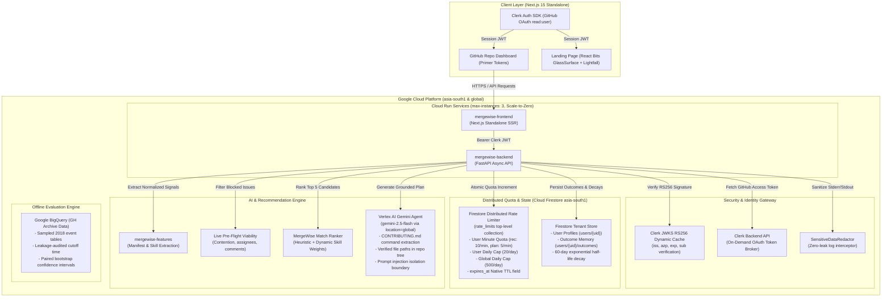

<p align="center">
  
</p>

<h1 align="center">MergeWise</h1>

<p align="center">
  <strong>Personalized Open-Source Issue Recommender & Grounded Implementation Agent</strong>
</p>

<p align="center">
  <a href="https://mergewise-frontend-708575763180.asia-south1.run.app"></a>
  <a href="https://mergewise-backend-708575763180.asia-south1.run.app/health"></a>
  <a href="https://nextjs.org/"></a>
  <a href="https://react.dev/"></a>
  <a href="https://fastapi.tiangolo.com/"></a>
  <a href="https://cloud.google.com/vertex-ai"></a>
  <a href="https://clerk.com/"></a>
  <a href="https://cloud.google.com/firestore"></a>
  
</p>

---

## Live Deployments & Demos

| Service | Environment | Status | Endpoint |
| :--- | :--- | :---: | :--- |
| **Frontend Web App** | Production (Cloud Run `asia-south1`) | `200 OK` | [https://mergewise-frontend-708575763180.asia-south1.run.app](https://mergewise-frontend-708575763180.asia-south1.run.app) |
| **Backend REST API** | Production (Cloud Run `asia-south1`) | `Healthy` | [https://mergewise-backend-708575763180.asia-south1.run.app/health](https://mergewise-backend-708575763180.asia-south1.run.app/health) |
| **Interactive Preview** | Static Mock Showcase | `Ready` | [https://mergewise-frontend-708575763180.asia-south1.run.app/preview](https://mergewise-frontend-708575763180.asia-south1.run.app/preview) |
| **GitHub Repository** | Source & Version Control | `Main` | [https://github.com/Neelanshdosi/MergeWise](https://github.com/Neelanshdosi/MergeWise) |

---

## Overview

Contributing to open-source software as a newcomer is fraught with friction:
- **Good-first-issue fatigue**: Issues labeled `good first issue` are frequently already claimed, blocked by competing unmerged PRs, or abandoned by unresponsive maintainers.
- **Skill mismatch**: Generic keyword search fails to correlate an issue with a developer's actual commit footprint, tooling familiarity, and package manifest dependencies.
- **Blank canvas paralysis**: Newcomers struggle to configure complex local build environments or locate exact target files without maintainer guidance.

**MergeWise** solves this end-to-end:
1. **Automated Skill Footprinting**: Ingests your public GitHub commit history and repository manifests (`package.json`, `pyproject.toml`, `Cargo.toml`, `go.mod`) to compute an objective skill profile without requiring manual resume entry.
2. **Pre-Flight Viability & Contention Filtering**: Verifies live candidate issues through real-time GitHub API checks—filtering out issues with existing PR contention, assigned contributors, or inactive maintainers.
3. **Grounded Starter Plans via Google Vertex AI (`gemini-2.5-flash`)**: Generates an actionable, verified implementation plan citing exact setup and test commands from `CONTRIBUTING.md`, verified files to edit in the repository tree, and a draft maintainer claim comment.
4. **Dynamic Outcome Memory with 60-Day Half-Life Decay**: Tracks outcomes (`pr_opened`, `too_hard`, `merged`, `skipped`) in Cloud Firestore, shifting personalized skill weights dynamically.
5. **Open-Source Contribution Tracker & Progression Funnel**: Ingests external PRs across all open-source repositories to measure real-world developer growth from discovery to merged code.

---

## Recent Major Updates

### 1. GitHub-Themed Repository Dashboard
The signed-in dashboard has been restyled to match GitHub's repository interface:
- **Global Header**: Custom MergeWise silhouette logo, user breadcrumb (`<login> / MergeWise`), mobile navigation drawer, theme toggle, and live API status dot.
- **Underline Navigation**: Tabbed workflow with live badge counts:
  - **Recommended** (viable matching newcomer issues)
  - **My contributions** (external open-source pull requests)
  - **Progress** (5-stage progression funnel and skill distribution)
- **Keyboard Shortcuts**: Pressing `/` focuses the issue search bar instantly; `Esc` clears the query.
- **File-List Styled Issue Table**: Header bar mimicking latest commit status with expandable pipeline telemetry (`Scanned N candidates, M passed viability`), match score rings, contention/viability status badges, star counts, and expandable matching logic.
- **Sidebar**: Repository About section, Live Metrics (merged PRs, repos contributed), segmented multi-color language breakdown, and Danger Zone (user data deletion).

### 2. Open-Source Contributions Tracker & Progression Funnel
- **Cross-Repo Contribution Ingestion**: Queries `is:pr author:<login> -user:<login>` to track all external open-source contributions.
- **`Via MergeWise` Correlation**: Cross-references referenced issue numbers in PR descriptions (`Fixes #123`) against MergeWise recommendation records.
- **5-Stage Conversion Funnel**: Tracks the developer journey: `Shown` &rarr; `Plan Viewed` &rarr; `Attempted` &rarr; `PR Opened` &rarr; `Merged`.

### 3. React Bits Modern Landing Page
- **Visual Design**: Aesthetic `#0E1116` canvas with dynamic `Lightfall` background animations.
- **GlassSurface Component**: Interactive glassmorphic cards and buttons with WebGL/CSS displacement and chromatic refraction.
- **Frictionless Onboarding**: Direct Clerk OAuth authentication with zero token exposure.

### 4. Production Cloud Run Deployment & Dynamic JWKS Auth
- **Scale-to-Zero Microservices**: Fully deployed on Google Cloud Run (`asia-south1`) with automatic scaling ($0 \to 3$ instances).
- **Dynamic JWKS Public Key Caching**: Backend fetches and caches Clerk RS256 public keys asynchronously from `/.well-known/jwks.json`.
- **Zero Secret Leakage**: `SensitiveDataRedactor` intercepts and scrubs GitHub tokens, Bearer headers, and Clerk keys from all logs.

---

## System Architecture



---

## Security & Isolation Architecture

MergeWise enforces multi-layer enterprise security standards across identity, token handling, multi-tenant isolation, prompt injection defense, and distributed rate limiting:

### 1. Cryptographic JWT Verification (Clerk RS256)
- **Token Format**: Validates standard RS256-signed JWTs issued by Clerk.
- **Dynamic JWKS Caching**: Asynchronously fetches public keys from `{CLERK_ISSUER}/.well-known/jwks.json` and caches them in memory (`TTL = 3600s`).
- **Strict Claims Validation**:
  - `exp`: Confirms the token has not expired against the UTC system clock.
  - `iss`: Matches `CLERK_ISSUER` strictly (rejecting foreign Clerk tenants).
  - `azp` (Authorized Party): Strictly matches configured frontend origins (`FRONTEND_URL` or `CLERK_AUTHORIZED_PARTIES`), preventing cross-site token relay.
  - `sub`: Identifies the immutable Clerk User ID.

### 2. Zero-Leak Token Handling & Logging Redaction
- **On-Demand Token Brokering**: GitHub OAuth tokens are fetched on demand from Clerk and never stored in databases, cookies, or `localStorage`. The backend queries Clerk's Backend API on demand (`/v1/users/{user_id}/oauth_access_tokens/oauth_github`) over TLS.
- **`SensitiveDataRedactor`**: A custom Python logging filter intercepts every log entry emitted to standard output, standard error, or Google Cloud Logging. It regex-scrubs GitHub PATs (`ghp_`, `gho_`), Bearer authorization headers, and Clerk secret keys (`sk_live_`, `sk_test_`), ensuring zero secret leakage to log aggregators.

### 3. Multi-Tenant Firestore Isolation & Quota Preservation
- **Tenant Hierarchy**: All user-specific personal data is partitioned strictly under `users/{user_id}/` in Cloud Firestore:
  - Skill Profile: `users/{user_id}`
  - Outcome Tracking: `users/{user_id}/outcomes/{safe_doc_id}`
- **Rate-Limit Quotas in Top-Level Collection**: Rate-limit counters are maintained in a top-level `rate_limits` collection (keyed by sanitized `user_id` and time bucket), outside `users/{user_id}/`. They contain no personal content and are excluded from user data deletion to prevent quota-reset evasion.
- **Cross-Tenant Guard**: User $A$ cannot query, mutate, or read data belonging to User $B$. All queries are scoped strictly by the authenticated `user_id` parsed from the validated JWT `sub` claim.
- **User-Initiated Data Deletion**: `delete_all_user_data` recursively deletes all documents and subcollections rooted under `users/{user_id}` and purges in-memory caches, while keeping top-level quota records intact.

### 4. Prompt-Injection Guard & Bounded Tools
- **Instruction Boundary**: In `GeminiPlanAgent`, user input and untrusted issue descriptions from GitHub are isolated from system instructions using explicit boundary framing. The system prompt instructs Gemini to treat issue text strictly as passive data and never execute embedded directives.
- **Path Whitelisting**: File inspection tools only access repo paths verified to exist in the repository tree; path traversal (`../`) and arbitrary remote URL fetching are rejected.
- **Bounded Iteration**: Tool loops are limited to a maximum of 8 calls, preventing denial-of-wallet tool recursion.

### 5. Distributed Firestore Rate Limits & Quotas
Cloud Run instances scale to zero and do not share in-memory state. Rate limits are tracked across instances using **atomic Firestore transactions** in the `rate_limits` collection:
- **Recommendations**: Bounded per user by `RATE_LIMIT_RECOMMENDATIONS_PER_MINUTE` (default: 10/min).
- **Plan Generation**: Bounded per user by `RATE_LIMIT_PLAN_PER_MINUTE` (default: 5/min).
- **User Daily Cap**: Bounded per user by `GEMINI_USER_DAILY_CAP` (default: 20/day) to prevent quota depletion.
- **Global Daily Cap**: Bounded across all users by `GEMINI_GLOBAL_DAILY_CAP` (default: 500/day) to safeguard Vertex AI billing.
- **Quota Protection**: Cache hits and failed LLM calls **never consume** the daily Gemini caps. Only successful LLM generation calls increment the quota counters.
- **Automated TTL Expiration**: Every counter document includes an `expires_at` timestamp field enabling Firestore Native Time-To-Live (TTL) automatic document cleanup.
- **Clear 429 Responses**: Returns `HTTP 429 Too Many Requests` with exact reset ISO timestamps and standard RFC `Retry-After: <seconds>` headers.

### 6. Production API Hardening
When `ENVIRONMENT=production`, FastAPI automatically disables Swagger UI (`/docs`), ReDoc (`/redoc`), and the OpenAPI schema (`/openapi.json`), returning `HTTP 404` to eliminate attack surface enumeration.

---

## Quickstart & Local Setup

### Prerequisites
- **Python**: 3.11+
- **Node.js**: 18+ and `npm`
- **Google Cloud SDK (`gcloud`)**: authenticated via `gcloud auth application-default login`
- **Clerk Account**: with GitHub OAuth provider enabled

### Local Configuration

1. **Clone the repository**:
   ```bash
   git clone https://github.com/Neelanshdosi/MergeWise.git
   cd MergeWise
   ```

2. **Backend Setup**:
   ```bash
   cd backend
   python -m venv venv
   source venv/bin/activate  # Or `.\venv\Scripts\activate` on Windows
   pip install -r requirements.txt
   pip install -e ../shared
   ```
   Create `backend/.env` with:
   ```env
   ENVIRONMENT=development
   PORT=8000
   FRONTEND_URL=http://localhost:3000
   CLERK_SECRET_KEY=sk_test_...
   CLERK_PUBLISHABLE_KEY=pk_test_...
   CLERK_ISSUER=https://mutual-panther-6595.clerk.accounts.dev
   CLERK_AUTHORIZED_PARTIES=["http://localhost:3000","http://localhost:3005"]
   GEMINI_MODEL_ID=gemini-2.5-flash
   GCP_PROJECT_ID=oss-match
   GCP_LOCATION=global
   FIRESTORE_DATABASE_ID=(default)
   RATE_LIMIT_ENABLED=true
   RATE_LIMIT_RECOMMENDATIONS_PER_MINUTE=10
   RATE_LIMIT_PLAN_PER_MINUTE=5
   GEMINI_USER_DAILY_CAP=20
   GEMINI_GLOBAL_DAILY_CAP=500
   ```

3. **Frontend Setup**:
   ```bash
   cd ../frontend
   npm install
   ```
   Create `frontend/.env.local`:
   ```env
   NEXT_PUBLIC_CLERK_PUBLISHABLE_KEY=pk_test_...
   CLERK_SECRET_KEY=sk_test_...
   NEXT_PUBLIC_API_URL=http://localhost:8000
   ```

4. **Running Locally**:
   - Backend:
     ```bash
     cd backend && uvicorn app.main:app --reload --port 8000
     ```
   - Frontend:
     ```bash
     cd frontend && npm run dev
     ```

5. **Running Tests**:
   - Frontend unit tests (13 tests):
     ```bash
     cd frontend && npm test
     ```
   - Backend test suite (97 tests):
     ```bash
     cd backend && pytest
     ```

---

## Production Cloud Run Deployment

Both microservices are deployed on **Google Cloud Run** in `asia-south1` (Mumbai) with Vertex AI Gemini in `global`:

| Microservice | Production Live URL | Configuration |
| :--- | :--- | :--- |
| **Frontend** | `https://mergewise-frontend-708575763180.asia-south1.run.app` | Next.js 15 Standalone, Scale-to-Zero, `max-instances=3` |
| **Backend** | `https://mergewise-backend-708575763180.asia-south1.run.app` | FastAPI, Python 3.11, Scale-to-Zero, `max-instances=3` |

### Automated Deployment via Script
```bash
# Deploys both frontend and backend to Cloud Run, binds secrets, and configures CORS
bash deploy/deploy_cloudrun.sh
```

---

## Phase 5 Evaluation Benchmark (Audited Offline Backtest)

To evaluate whether MergeWise's ranking features help identify issues a newcomer will successfully resolve, we ran an offline evaluation using historical GitHub Archive data.

> [!IMPORTANT]
> **Evaluation Data & Scope**:
> - **Sampled Window**: Evaluated on 4 sampled dates across early 2018 (`2018-01-15`, `2018-02-15`, `2018-03-15`, `2018-04-15`).
> - **Offline Backtest Only**: These numbers reflect an offline backtest on historical event archives, not live serving metrics.
> - **Production Deployment Note**: The LightGBM LambdaRank model is evaluated here as a benchmark candidate; the live application currently serves using the **MergeWise Heuristic Ranker** layered with real-time Firestore outcome memory decay adjustments.

---

### 1. Offline Ranking Performance Results

Evaluated across candidate pools with exactly **one true merged positive** per newcomer query.

#### Standard Candidate Pool ($K = 15$ candidates per pool)

| Ranking Method | Hit@1 (95% CI) | Hit@3 (95% CI) | Hit@5 (95% CI) | MRR (95% CI) | Test Pools |
| :--- | :---: | :---: | :---: | :---: | :---: |
| **Language-Match Only** | **0.124** [0.084, 0.164] | **0.318** [0.266, 0.372] | **0.456** [0.401, 0.518] | **0.297** [0.262, 0.334] | 274 |
| **MergeWise Heuristic Ranker** | 0.062 [0.040, 0.091] | 0.274 [0.219, 0.336] | 0.442 [0.390, 0.504] | 0.253 [0.227, 0.284] | 274 |
| **Repo-Stars Only** | 0.077 [0.047, 0.109] | 0.219 [0.171, 0.270] | 0.361 [0.303, 0.416] | 0.236 [0.211, 0.263] | 274 |
| **Random Good-First-Issue** | 0.062 [0.040, 0.091] | 0.223 [0.186, 0.277] | 0.325 [0.285, 0.387] | 0.224 [0.204, 0.254] | 274 |
| **MergeWise LightGBM (LambdaRank)** | 0.047 [0.026, 0.069] | 0.175 [0.135, 0.215] | 0.321 [0.270, 0.376] | 0.199 [0.178, 0.220] | 274 |
| **Newest-First** | 0.036 [0.015, 0.058] | 0.168 [0.120, 0.215] | 0.292 [0.234, 0.354] | 0.198 [0.171, 0.220] | 274 |

#### Paired Comparisons with Bootstrap Confidence Intervals ($\Delta = A - B$, $K = 15$)

To evaluate whether performance differences are statistically meaningful, we compute per-query paired differences and 95% bootstrap confidence intervals ($N=1000$ resamples):

| Paired Comparison ($\Delta = A - B$) | $\Delta$ Hit@1 (95% CI) | $\Delta$ Hit@3 (95% CI) | $\Delta$ Hit@5 (95% CI) | $\Delta$ MRR (95% CI) |
| :--- | :---: | :---: | :---: | :---: |
| **Heuristic vs Language-Match** | -0.062 [-0.109, -0.015] | -0.044 [-0.113, +0.022] | -0.015 [-0.091, +0.058] | -0.045 [-0.085, -0.008] |
| **Heuristic vs Random** | +0.000 [-0.036, +0.033] | +0.051 [-0.015, +0.117] | +0.117 [+0.033, +0.197] | +0.029 [-0.006, +0.064] |

#### Larger Candidate Pool Variant ($K = 50$ candidates per pool)

| Ranking Method | Hit@1 (95% CI) | Hit@3 (95% CI) | Hit@5 (95% CI) | MRR (95% CI) | Test Pools |
| :--- | :---: | :---: | :---: | :---: | :---: |
| **MergeWise Heuristic Ranker** | **0.022** [0.007, 0.036] | **0.099** [0.066, 0.128] | **0.146** [0.102, 0.186] | **0.116** [0.097, 0.134] | 274 |
| **Language-Match Only** | 0.022 [0.004, 0.040] | 0.080 [0.051, 0.113] | 0.131 [0.091, 0.168] | 0.103 [0.086, 0.125] | 274 |
| **Newest-First** | 0.011 [0.000, 0.026] | 0.062 [0.033, 0.088] | 0.102 [0.066, 0.135] | 0.083 [0.067, 0.100] | 274 |
| **Repo-Stars Only** | 0.022 [0.004, 0.047] | 0.051 [0.026, 0.080] | 0.095 [0.055, 0.131] | 0.087 [0.069, 0.113] | 274 |
| **Random Good-First-Issue** | 0.011 [0.000, 0.022] | 0.051 [0.029, 0.080] | 0.095 [0.062, 0.128] | 0.081 [0.066, 0.097] | 274 |
| **MergeWise LightGBM (LambdaRank)** | 0.015 [0.004, 0.029] | 0.058 [0.033, 0.088] | 0.091 [0.058, 0.128] | 0.084 [0.067, 0.102] | 274 |

---

### 2. Leakage Audit & Sanity Tests

To ensure results are free from lookahead leakage or synthetic data artifacts, we executed ablation sanity checks:

| Sanity Test Experiment | Hit@1 | Hit@3 | Hit@5 | MRR | Finding |
| :--- | :---: | :---: | :---: | :---: | :--- |
| **(a) Shuffled Labels within Pools** | 0.058 | 0.175 | 0.303 | 0.210 | Confirmed: scores at random chance level ($\approx 5/15 = 0.333$). |
| **(b) Drop All User Features** | 0.073 | 0.204 | 0.296 | 0.216 | Confirmed: scores at random level (~0.30), showing user features did not provide within-pool rank gain. |
| **(c) Drop Repo Stars & Identifiers** | 0.073 | 0.212 | 0.336 | 0.229 | Confirmed: scores at random chance level (~0.34). |

#### Within-Pool Feature Variance Audit

Features with **0.000000** within-pool variance represent user-level attributes (`user_total_commits`, `recency_weighted_activeness`) that are identical across all candidate issues in a given query. In pairwise/listwise LambdaRank, these attributes cannot directly rank candidates within a pool. True ranking discrimination comes from candidate-level (`repo_stars_log`, labels) and interaction features (`lang_match`, `lang_commit_share`).

| Feature | Within-Pool Variance | Role in Query Pool |
| :--- | :---: | :--- |
| `lang_match` | **0.204027** | Interaction (User skills $\times$ Issue repo language) |
| `lang_commit_share` | **0.179258** | Interaction (User commit history in repo language) |
| `repo_stars_log` | **0.663479** | Candidate feature (Repository popularity) |
| `has_good_first_issue_label` | **0.236500** | Candidate feature |
| `has_help_wanted_label` | **0.214404** | Candidate feature |
| `user_total_commits`, `user_total_prs`, etc. | **0.000000** | User constant across candidate pool (no within-pool variance) |

---

## Two-Minute Interactive Demo Script

Use this script to guide a 2-minute live presentation or evaluation walkthrough:

```
[0:00 - 0:25] THE NEWCOMER PROBLEM & AUTHENTICATION
Presenter: "Getting into open source is notoriously intimidating: issues labeled 'good first issue'
are often already solved, abandoned by maintainers, or outside your skill level.
Let's see how MergeWise solves this."
Action: Visit https://mergewise-frontend-708575763180.asia-south1.run.app and click "Sign In with GitHub".
Sign in using Clerk OAuth. Point out that the session token is an RS256 JWT, with zero credentials
stored in the browser.

[0:25 - 0:50] GITHUB-THEMED REPO DASHBOARD & PRE-FLIGHT VIABILITY
Presenter: "Notice the interface: it's built directly around GitHub's familiar repository layout,
featuring underline navigation across 'Recommended', 'My contributions', and 'Progress'.
Without asking you for a resume, MergeWise ingests your public GitHub commits and manifests.
Look at the issue table: notice the green 'Viable' badges and match scores.
MergeWise didn't just search GitHub; it performed live pre-flight checks:
1. No competing open PRs are already solving it
2. No assignee has claimed it
3. Maintainers actively review newcomer PRs within days."
Action: Press '/' on the keyboard to filter issues in real-time, then press 'Esc' to clear.

[0:50 - 1:25] GROUNDED STARTER PLAN WITH VERTEX AI (gemini-2.5-flash)
Presenter: "Finding an issue is only half the battle. Now we need to know how to solve it."
Action: Click "How to Start" on an issue row to open the implementation starter plan.
Presenter: "In the background, our Vertex AI Gemini agent inspected the repository using sandboxed GitHub tools:
- It extracted the exact setup command ('pip install -e .') citing CONTRIBUTING.md
- It verified the exact test command ('pytest tests/')
- It verified the specific source file you need to modify in the repo tree
- It drafted a respectful maintainer claim comment ready to copy with one click."

[1:25 - 1:45] OUTCOME MEMORY & DYNAMIC FEEDBACK LOOP
Presenter: "What happens if this issue was too difficult or you opened a pull request?"
Action: Click the 'Too Hard' or 'PR Opened' outcome button on an issue.
Presenter: "MergeWise writes this outcome to Cloud Firestore. Using exponential time decay with a
60-day half-life, the ranking engine dynamically shifts topic weights. Future recommendations
will de-prioritize this sub-topic without completely blacklisting it."

[1:45 - 2:00] CONTRIBUTIONS TRACKING & CLOUD RUN PRODUCTION
Presenter: "Click over to 'My contributions' to view all your external open-source PRs,
complete with 'Via MergeWise' badges and our 5-stage progression funnel.
In production, MergeWise runs scale-to-zero microservices on Google Cloud Run in asia-south1.
Documentation routes (/docs) are disabled in production, tokens are scrubbed from logs via
SensitiveDataRedactor, and Firestore-backed rate limiters enforce strict per-user and global AI quotas."
Action: Show the Contributions tab and the passing health check at /health.
```

---

## License

This project is licensed under the [MIT License](LICENSE).
<br>
<sub>*Disclaimer: MergeWise is an independent open-source tool and is not affiliated with, sponsored by, or endorsed by GitHub, Inc.*</sub>
