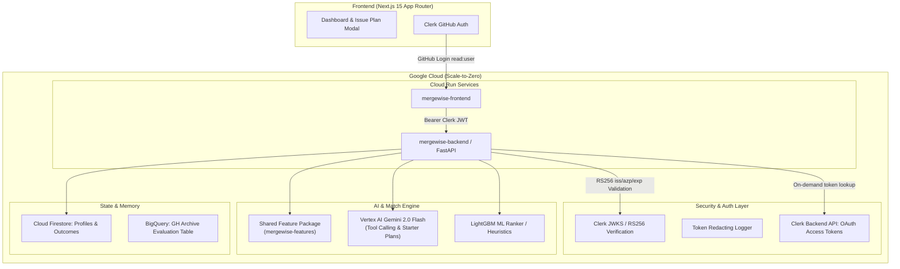

# MergeWise — OSS Match Agent

A personalized open-source issue recommender that analyzes your GitHub footprint to build a skill profile, finds public open-source issues you can realistically finish, verifies live viability, and drafts an actionable starter plan with outcome memory.

---

## Architecture Overview

---

## Phase 1 Acceptance Status: COMPLETED

- [x] **Backend Skeleton**: FastAPI configured with restricted CORS and health check `/health`.
- [x] **Zero-Leak Token Redaction**: Custom `SensitiveDataRedactor` intercepts all logs to prevent GitHub tokens, Bearer strings, or Clerk keys from leaking into stdout/logs.
- [x] **Clerk JWT Verification**: Strict validation of `exp`, `iss` (Clerk instance), and `azp` (Authorized Party/Frontend origin).
- [x] **Clerk Backend GitHub Token Broker**: Verified against current Clerk Backend API (`/v1/users/{user_id}/oauth_access_tokens/oauth_github`).
- [x] **Shared Feature Core**: `shared/mergewise_features` package created for identical feature calculations across live serving and offline evaluation.
- [x] **Frontend**: Next.js App Router with Clerk GitHub login, rich glassmorphic dashboard, and live backend verification card.
- [x] **Automated Tests**: Unit tests for JWT validation, expired tokens, azp mismatch, endpoint auth, and token log redaction all passing (`pytest tests/ -v`).
- [x] **Cloud Run Infrastructure**: Dockerfiles for both services and deployment scripts (`deploy/setup_gcp.sh`, `deploy/deploy_cloudrun.sh`).
