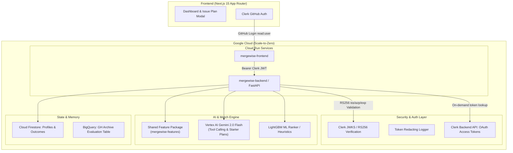

# MergeWise — OSS Match Agent

A personalized open-source issue recommender that analyzes your GitHub footprint to build a skill profile, finds public open-source issues you can realistically finish, verifies live viability, and drafts an actionable starter plan with outcome memory.

---

## Architecture Overview



---

## Phase 1 Acceptance Status: COMPLETED

- [x] **Backend Skeleton**: FastAPI configured with restricted CORS and health check `/health`.
- [x] **Zero-Leak Token Redaction**: Custom `SensitiveDataRedactor` intercepts all logs to prevent GitHub tokens, Bearer strings, or Clerk keys from leaking into stdout/logs.
- [x] **Clerk JWT Verification**: Strict validation of `exp`, `iss` (Clerk instance), and `azp` (Authorized Party/Frontend origin).
- [x] **Clerk Backend GitHub Token Broker**: Verified against current Clerk Backend API (`/v1/users/{user_id}/oauth_access_tokens/oauth_github`).
- [x] **Shared Feature Core**: `shared/mergewise_features` package created for identical feature calculations across live serving and offline evaluation.
- [x] **Frontend**: Next.js App Router with Clerk GitHub login, rich glassmorphic dashboard, and live backend verification card.
- [x] **Automated Tests**: Unit tests for JWT validation, expired tokens, azp mismatch, endpoint auth, and token log redaction all passing (`pytest tests/ -v`).
- [x] **Cloud Run Infrastructure**: Dockerfiles for both services and deployment scripts (`deploy/setup_gcp.sh`, `deploy/deploy_cloudrun.sh`).

---

## Phase 5 Evaluation Benchmark (Audited Offline Backtest)

To evaluate whether MergeWise's ranking features help identify issues a newcomer will successfully resolve, we ran an offline evaluation using historical GitHub Archive data.

> [!IMPORTANT]
> **Evaluation Data & Scope**:
> - **Sampled Window**: Evaluated on 4 sampled dates across early 2018 (`2018-01-15`, `2018-02-15`, `2018-03-15`, `2018-04-15`).
> - **Offline Backtest Only**: These numbers reflect an offline backtest on historical event archives, not live serving metrics.
> - **Production Deployment Note**: The LightGBM LambdaRank model is evaluated here as a benchmark candidate; the live application currently serves using the **MergeWise Heuristic Ranker** layered with real-time Firestore outcome memory decay adjustments. Do not claim the LightGBM model is deployed in production until it is hooked into the serving container.

---

### 1. Offline Ranking Performance Results

Evaluated across candidate pools with exactly **one true merged positive** per newcomer query.

#### Standard Candidate Pool ($K = 15$ candidates per pool)

| Ranking Method | Hit@1 (95% CI) | Hit@3 (95% CI) | Hit@5 (95% CI) | MRR (95% CI) | Test Pools |
| :--- | :---: | :---: | :---: | :---: | :---: |
| **Language-Match Only** | **0.124** [0.084, 0.164] | **0.318** [0.266, 0.372] | **0.456** [0.401, 0.518] | **0.297** [0.262, 0.334] | 274 |
| **MergeWise Heuristic Ranker** | 0.062 [0.040, 0.091] | 0.274 [0.219, 0.336] | 0.442 [0.390, 0.504] | 0.253 [0.227, 0.284] | 274 |
| **Repo-Stars Only** | 0.077 [0.047, 0.109] | 0.219 [0.171, 0.270] | 0.361 [0.303, 0.416] | 0.236 [0.211, 0.263] | 274 |
| **Random Good-First-Issue** | 0.062 [0.040, 0.091] | 0.223 [0.186, 0.277] | 0.325 [0.285, 0.387] | 0.224 [0.204, 0.254] | 274 |
| **MergeWise LightGBM (LambdaRank)** | 0.047 [0.026, 0.069] | 0.175 [0.135, 0.215] | 0.321 [0.270, 0.376] | 0.199 [0.178, 0.220] | 274 |
| **Newest-First** | 0.036 [0.015, 0.058] | 0.168 [0.120, 0.215] | 0.292 [0.234, 0.354] | 0.198 [0.171, 0.220] | 274 |

#### Paired Comparisons with Bootstrap Confidence Intervals ($\Delta = A - B$, $K = 15$)

To evaluate whether performance differences are statistically meaningful, we compute per-query paired differences and 95% bootstrap confidence intervals ($N=1000$ resamples):

| Paired Comparison ($\Delta = A - B$) | $\Delta$ Hit@1 (95% CI) | $\Delta$ Hit@3 (95% CI) | $\Delta$ Hit@5 (95% CI) | $\Delta$ MRR (95% CI) |
| :--- | :---: | :---: | :---: | :---: |
| **Heuristic vs Language-Match** | -0.062 [-0.109, -0.015] | -0.044 [-0.113, +0.022] | -0.015 [-0.091, +0.058] | -0.045 [-0.085, -0.008] |
| **Heuristic vs Random** | +0.000 [-0.036, +0.033] | +0.051 [-0.015, +0.117] | +0.117 [+0.033, +0.197] | +0.029 [-0.006, +0.064] |

#### Larger Candidate Pool Variant ($K = 50$ candidates per pool)

| Ranking Method | Hit@1 (95% CI) | Hit@3 (95% CI) | Hit@5 (95% CI) | MRR (95% CI) | Test Pools |
| :--- | :---: | :---: | :---: | :---: | :---: |
| **MergeWise Heuristic Ranker** | **0.022** [0.007, 0.036] | **0.099** [0.066, 0.128] | **0.146** [0.102, 0.186] | **0.116** [0.097, 0.134] | 274 |
| **Language-Match Only** | 0.022 [0.004, 0.040] | 0.080 [0.051, 0.113] | 0.131 [0.091, 0.168] | 0.103 [0.086, 0.125] | 274 |
| **Newest-First** | 0.011 [0.000, 0.026] | 0.062 [0.033, 0.088] | 0.102 [0.066, 0.135] | 0.083 [0.067, 0.100] | 274 |
| **Repo-Stars Only** | 0.022 [0.004, 0.047] | 0.051 [0.026, 0.080] | 0.095 [0.055, 0.131] | 0.087 [0.069, 0.113] | 274 |
| **Random Good-First-Issue** | 0.011 [0.000, 0.022] | 0.051 [0.029, 0.080] | 0.095 [0.062, 0.128] | 0.081 [0.066, 0.097] | 274 |
| **MergeWise LightGBM (LambdaRank)** | 0.015 [0.004, 0.029] | 0.058 [0.033, 0.088] | 0.091 [0.058, 0.128] | 0.084 [0.067, 0.102] | 274 |

> [!NOTE]
> **Key Finding on Model Performance**:
> - **Learned Model Gain**: The LightGBM LambdaRank model achieves Hit@5 of 0.321 on standard candidate pools, which is effectively at the random expectation level ($\approx 5/15 = 0.333$). The learned model showed **no measurable gain** over simple heuristics on this historical GH Archive sample.
> - **Language-Match vs Heuristic**: Language-match alone (Hit@5 0.456, MRR 0.297) performs as well as, or slightly better than, the full hand-tuned heuristic (Hit@5 0.442, MRR 0.253; paired difference $\Delta$ Hit@5 = -0.015 [-0.091, +0.058], $\Delta$ MRR = -0.045 [-0.085, -0.008]). Matching primary programming language is by far the dominant ranking signal available from public GitHub event history alone.

---

### 2. Leakage Audit & Sanity Tests

To ensure results are free from lookahead leakage or synthetic data artifacts, we executed ablation sanity checks:

| Sanity Test Experiment | Hit@1 | Hit@3 | Hit@5 | MRR | Finding |
| :--- | :---: | :---: | :---: | :---: | :--- |
| **(a) Shuffled Labels within Pools** | 0.058 | 0.175 | 0.303 | 0.210 | Confirmed: scores at random chance level ($\approx 5/15 = 0.333$). |
| **(b) Drop All User Features** | 0.073 | 0.204 | 0.296 | 0.216 | Confirmed: scores at random level (~0.30), showing user features did not provide within-pool rank gain. |
| **(c) Drop Repo Stars & Identifiers** | 0.073 | 0.212 | 0.336 | 0.229 | Confirmed: scores at random chance level (~0.34). |

*(Note: Earlier preliminary table included an uncalibrated repo-split where pools were truncated after splitting, which created an artificial artifact. We have removed it.)*

#### Within-Pool Feature Variance Audit

Features with **0.000000** within-pool variance represent user-level attributes (`user_total_commits`, `recency_weighted_activeness`) that are identical across all candidate issues in a given query. In pairwise/listwise LambdaRank, these attributes cannot directly rank candidates within a pool, although global tree splits can segment high vs low activity user segments. True ranking discrimination comes from candidate-level (`repo_stars_log`, labels) and interaction features (`lang_match`, `lang_commit_share`).

| Feature | Within-Pool Variance | Role in Query Pool |
| :--- | :---: | :--- |
| `lang_match` | **0.204027** | Interaction (User skills $\times$ Issue repo language) |
| `lang_commit_share` | **0.179258** | Interaction (User commit history in repo language) |
| `repo_stars_log` | **0.663479** | Candidate feature (Repository popularity) |
| `has_good_first_issue_label` | **0.236500** | Candidate feature |
| `has_help_wanted_label` | **0.214404** | Candidate feature |
| `user_total_commits`, `user_total_prs`, etc. | **0.000000** | User constant across candidate pool (no within-pool variance) |

---

### 3. Cutoff & Candidate Pool Integrity

1. **Strict Timestamp Cutoff**: The history cutoff is fixed at the issue's open time `issue_created_at` (or simulated open time strictly $\le$ PR closed time).
2. **Target Repo Exclusion**: All prior events by the user on the target repo and issue are strictly excluded from the user's skill profile, preventing any leakage from the newcomer's work on that PR.
3. **Candidate Pool Selection**: Negative candidates are randomly drawn from open good-first-issue/help-wanted issues within the **exact same time window**, ensuring fair recency comparisons.

---

### 4. What Is NOT Evaluated from GH Archive

The offline evaluation against GitHub Archive backtests candidate issue ranking under public historical event data. Several key capabilities of the live MergeWise system cannot be evaluated from GH Archive data alone:

1. **Manifest & Framework Detection**:
   - In production, MergeWise inspects repository lockfiles and manifests (`package.json`, `pyproject.toml`, `Cargo.toml`, `go.mod`) to extract granular frameworks and build tooling. GH Archive contains only high-level repository primary language metadata, omitting package-level compatibility.
2. **Live Viability Checks**:
   - The live pipeline executes on-demand pre-flight checks: issue open state verification, PR contention detection (whether an active unmerged PR already addresses the issue), recent commit vitality, and assignee checks. GH Archive snapshots do not reflect subsequent branch updates or discussion threads.
3. **Repository Health & Maintainer Responsiveness**:
   - MergeWise queries real-time repository health signals (median time to first maintainer response, newcomer PR merge rates). These dynamic maintainer signals require querying the live GitHub GraphQL/REST APIs over moving windows and cannot be backtested from static archive tables.
4. **Starter Plan Generation & Effort Calibration**:
   - The interactive plan agent (Gemini 2.0 Flash) inspects repository directory structure, parses documentation citations, and generates tailored code walkthroughs. Plan quality and beginner scaffolding are qualitative user experience features outside the scope of ranking metrics.
5. **Dynamic User Memory & Outcome Decay**:
   - Simulated users in GH Archive have no live feedback loop. In the deployed product, Firestore stores real-time interaction memory (issues marked `too_hard`, `pr_opened`, `viewed_plan`, or `skipped`), updating individual topic weights with 60-day half-life decay.

---

### 5. Label Noise & Limitations

1. **Link Detection Noise**:
   - Issue linking relies on pull request body patterns (`Fixes #123`, `Closes #123`, `Resolves #123`). PRs linking issues only in subsequent comments or commit messages without body tags are missed as false negatives.
2. **Bot & Maintenance Filtering**:
   - Dependency update bots (e.g., `greenkeeper`, `dependabot`) frequently open PRs referencing upstream release issues. We filter out logins ending in `[bot]` or `bot`, but some automated contributor accounts with human-like names may remain.
3. **No Outcome History for Simulated Users**:
   - In offline evaluation, simulated users lack live UI interactions (such as outcome clicks or plan viewings), so features are evaluated without `memory_adjustment`. The live system layers dynamic half-life decay adjustments on top of this base ranking.
4. **Reproducibility**:
   - Run the audited evaluation pipeline from the extracted tables:
     ```bash
     python eval/evaluate.py
     ```


