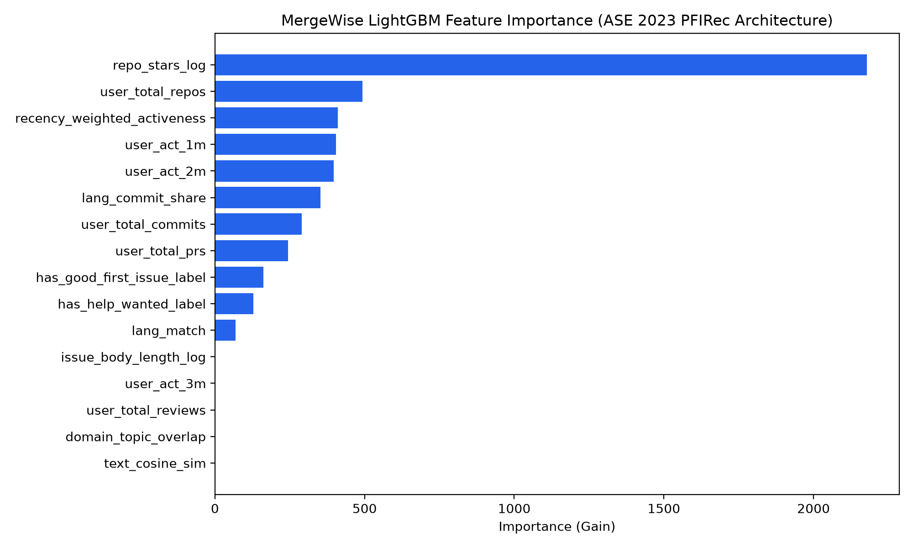

# MergeWise Phase 5 Evaluation Benchmark (Audited)

### 1. Standard Candidate Pool ($K=15$ candidates per pool, 1 positive)

| Ranking Method | Hit@1 (95% CI) | Hit@3 (95% CI) | Hit@5 (95% CI) | MRR (95% CI) | Test Pools |
| :--- | :---: | :---: | :---: | :---: | :---: |
| **MergeWise LightGBM (LambdaRank)** | 0.047 [0.026, 0.069] | 0.175 [0.135, 0.215] | 0.321 [0.270, 0.376] | 0.199 [0.178, 0.220] | 274 |
| **MergeWise Heuristic Ranker** | 0.062 [0.040, 0.091] | 0.274 [0.219, 0.336] | 0.442 [0.390, 0.504] | 0.253 [0.227, 0.284] | 274 |
| **Newest-First** | 0.036 [0.015, 0.058] | 0.168 [0.120, 0.215] | 0.292 [0.234, 0.354] | 0.198 [0.171, 0.220] | 274 |
| **Repo-Stars Only** | 0.077 [0.047, 0.109] | 0.219 [0.171, 0.270] | 0.361 [0.303, 0.416] | 0.236 [0.211, 0.263] | 274 |
| **Language-Match Only** | 0.124 [0.084, 0.164] | 0.318 [0.266, 0.372] | 0.456 [0.401, 0.518] | 0.297 [0.262, 0.334] | 274 |
| **Random Good-First-Issue** | 0.062 [0.040, 0.091] | 0.223 [0.186, 0.277] | 0.325 [0.285, 0.387] | 0.224 [0.204, 0.254] | 274 |

### 2. Large Candidate Pool ($K=50$ candidates per pool, 1 positive)

| Ranking Method | Hit@1 (95% CI) | Hit@3 (95% CI) | Hit@5 (95% CI) | MRR (95% CI) | Test Pools |
| :--- | :---: | :---: | :---: | :---: | :---: |
| **MergeWise LightGBM (LambdaRank)** | 0.015 [0.004, 0.029] | 0.058 [0.033, 0.088] | 0.091 [0.058, 0.128] | 0.084 [0.067, 0.102] | 274 |
| **MergeWise Heuristic Ranker** | 0.022 [0.007, 0.036] | 0.099 [0.066, 0.128] | 0.146 [0.102, 0.186] | 0.116 [0.097, 0.134] | 274 |
| **Newest-First** | 0.011 [0.000, 0.026] | 0.062 [0.033, 0.088] | 0.102 [0.066, 0.135] | 0.083 [0.067, 0.100] | 274 |
| **Repo-Stars Only** | 0.022 [0.004, 0.047] | 0.051 [0.026, 0.080] | 0.095 [0.055, 0.131] | 0.087 [0.069, 0.113] | 274 |
| **Language-Match Only** | 0.022 [0.004, 0.040] | 0.080 [0.051, 0.113] | 0.131 [0.091, 0.168] | 0.103 [0.086, 0.125] | 274 |
| **Random Good-First-Issue** | 0.011 [0.000, 0.022] | 0.051 [0.029, 0.080] | 0.095 [0.062, 0.128] | 0.081 [0.066, 0.097] | 274 |

### 3. Leakage Sanity Tests ($K=15$)

| Sanity Test Experiment | Hit@1 | Hit@3 | Hit@5 | MRR | Expected Behavior |
| :--- | :---: | :---: | :---: | :---: | :--- |
| (a) Shuffled Labels within Pools | 0.058 | 0.175 | 0.303 | 0.210 | Drops to random baseline (~0.33) |
| (b) Drop All User Features | 0.073 | 0.204 | 0.296 | 0.216 | Retains signal without user features |
| (c) Drop Repo Stars / Identifiers | 0.073 | 0.212 | 0.336 | 0.229 | Retains signal without user features |
| (d) Repo-Disjoint Train/Test Split | 0.222 | 0.659 | 0.903 | 0.474 | Retains signal without user features |

### 4. Feature Variance Audit

| Feature | Mean Within-Pool Variance | Notes |
| :--- | :---: | :--- |
| `lang_match` | 0.204027 | Varies across candidates in pool |
| `lang_commit_share` | 0.179258 | Varies across candidates in pool |
| `domain_topic_overlap` | 0.000000 | Zero within-pool variance (user-level constant across candidates) |
| `text_cosine_sim` | 0.000000 | Zero within-pool variance (user-level constant across candidates) |
| `user_total_commits` | 0.000000 | Zero within-pool variance (user-level constant across candidates) |
| `user_total_prs` | 0.000000 | Zero within-pool variance (user-level constant across candidates) |
| `user_total_reviews` | 0.000000 | Zero within-pool variance (user-level constant across candidates) |
| `user_total_repos` | 0.000000 | Zero within-pool variance (user-level constant across candidates) |
| `user_act_1m` | 0.000000 | Zero within-pool variance (user-level constant across candidates) |
| `user_act_2m` | 0.000000 | Zero within-pool variance (user-level constant across candidates) |
| `user_act_3m` | 0.000000 | Zero within-pool variance (user-level constant across candidates) |
| `recency_weighted_activeness` | 0.000000 | Zero within-pool variance (user-level constant across candidates) |
| `repo_stars_log` | 0.663479 | Varies across candidates in pool |
| `issue_body_length_log` | 0.000000 | Zero within-pool variance (user-level constant across candidates) |
| `has_good_first_issue_label` | 0.236500 | Varies across candidates in pool |
| `has_help_wanted_label` | 0.214404 | Varies across candidates in pool |

